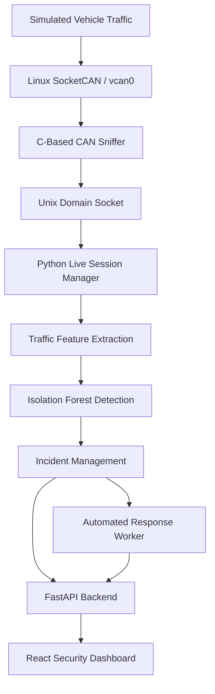
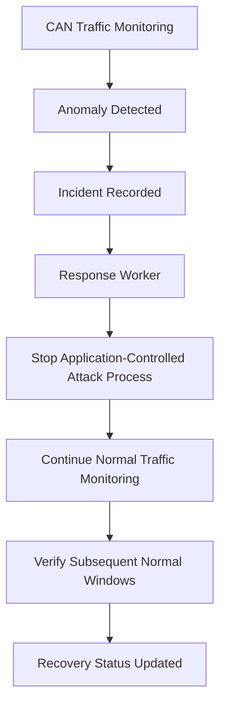

<div align="center">

# 🛡️ CAN-SENTINEL

### AUTOMOTIVE NETWORK INTRUSION DETECTION SYSTEM

**Real-Time CAN Bus Monitoring · ML-Based Anomaly Detection · Incident Response**

<p>
  
  
  
</p>

<p>
  
  
  
  
  
</p>

**An automotive network security prototype designed to identify suspicious CAN communication patterns and monitor security incidents.**

</div>

---

## 01 // PROJECT OVERVIEW

Modern vehicles rely on the Controller Area Network (CAN) protocol for communication between Electronic Control Units (ECUs).

However, traditional CAN communication does not provide built-in authentication or encryption at the frame level. This creates opportunities for unauthorized message injection, flooding, and abnormal communication patterns.

**CAN-Sentinel** is a prototype automotive intrusion detection system that monitors CAN traffic, analyzes communication behaviour using Machine Learning, and provides a centralized dashboard for security monitoring.

### Core Security Objectives

- Monitor real-time CAN bus communication.
- Identify abnormal message frequency and traffic patterns.
- Detect unexpected CAN identifiers and suspicious activity.
- Generate security incidents for investigation.
- Execute controlled responses against application-managed attack simulations.
- Monitor traffic recovery after simulated attacks.

---

## 02 // THREAT MODEL

CAN-Sentinel currently demonstrates detection against two simulated attack scenarios in an isolated virtual CAN environment.

| Threat Scenario | Demonstration |
|---|---|
| CAN Flooding | High-frequency frames using CAN ID `0x100` |
| Unexpected Identifier | Extended CAN identifier `0x999` |
| Traffic Anomalies | Unusual message frequency and distribution |
| Recovery Monitoring | Verification of subsequent normal traffic windows |

### Attack Simulation Examples

**Scenario A — High-Frequency CAN Flood**

- Target CAN ID: `0x100`
- Payload: `FF FF`
- Target transmission interval: 1 ms
- Detection objective: Identify abnormal message frequency.

**Scenario B — Unexpected Extended CAN ID**

- CAN ID: `0x999`
- Payload: `DE AD`
- Target transmission interval: 50 ms
- Detection objective: Identify unexpected extended-frame activity.

> All attack demonstrations are performed using an isolated virtual CAN interface (`vcan0`). No real vehicle network is targeted.

---

## 03 // SYSTEM ARCHITECTURE



### Data Pipeline

1. **Traffic Generation:** Simulated ECU messages are transmitted through `vcan0`.
2. **Frame Capture:** The C-based sniffer captures incoming CAN frames.
3. **Data Transfer:** Captured events are forwarded through a Unix Domain Socket.
4. **Feature Extraction:** Python processes incoming traffic into time-based feature windows.
5. **Anomaly Detection:** The existing Isolation Forest model evaluates traffic behaviour.
6. **Incident Processing:** Detected anomalies are recorded and made available to the dashboard.
7. **Response Monitoring:** Application-managed attack processes can be terminated and subsequent traffic monitored.

---

## 04 // MACHINE LEARNING DETECTION ENGINE

CAN-Sentinel uses an **Isolation Forest** model to identify unusual CAN traffic patterns.

The model evaluates traffic features extracted from one-second windows.

### Detection Features

- Total CAN frames
- Unique CAN identifiers
- Extended frame count
- Unique payload count
- Maximum CAN ID share
- Frequency of selected CAN identifiers
- Distribution of unexpected identifiers

### Model Configuration

| Parameter | Configuration |
|---|---|
| Algorithm | Isolation Forest |
| Estimators | 200 |
| Random State | 42 |
| Contamination | 0.02 |
| Window Duration | 1000 ms |

The existing trained model is retained to preserve the established detection baseline.

---

## 05 // SECURITY MONITORING DASHBOARD

The React-based dashboard provides a centralized interface for observing network activity and investigating detected incidents.

### Monitoring Capabilities

- Live CAN traffic visualization
- Network throughput monitoring
- CAN identifier distribution
- Anomaly alerts and incident details
- ECU signal impact mapping
- Response audit trail
- Live session monitoring and restoration
- Recovery status visualization

### Signal Mapping

| CAN ID | Simulated Signal |
|---|---|
| `0x100` | Engine RPM |
| `0x101` | Vehicle Speed |
| `0x102` | Coolant Temperature |
| `0x999` | Unexpected Extended Identifier |

---

## 06 // INCIDENT RESPONSE & RECOVERY

Detection is only one part of the security workflow.

CAN-Sentinel also implements an application-level response workflow.

### Response Lifecycle



The response worker can terminate attack simulator processes launched and managed by the application.

The system then evaluates subsequent traffic windows to monitor recovery.

**Important:** This is an application-level prototype response mechanism, not a physical CAN firewall or an in-vehicle blocking system.

---

## 07 // TECHNOLOGY STACK

| Component | Technology |
|---|---|
| CAN Traffic Generation | C |
| CAN Frame Capture | C / Linux SocketCAN |
| Network Interface | Virtual CAN (`vcan0`) |
| Backend | Python |
| API Framework | FastAPI |
| Machine Learning | Scikit-learn |
| Detection Algorithm | Isolation Forest |
| Frontend | React |
| Language | TypeScript |
| Inter-process Communication | Unix Domain Socket |
| Operating Environment | Linux / Kali Linux |

---

## 08 // INSTALLATION & EXECUTION

### Prerequisites

- Linux environment
- Python 3
- C compiler
- Linux SocketCAN utilities
- Node.js and npm
- Project dependencies

### Step 1 — Configure Virtual CAN

```bash
sudo modprobe vcan
sudo ip link add dev vcan0 type vcan
sudo ip link set vcan0 up
```

Verify:

```bash
ip -details link show vcan0
```

### Step 2 — Start Backend

```bash
cd /media/sf_updated_internship

source ~/can-sentinel-env/bin/activate

export PYTHONPATH="$PWD/src"

python -m uvicorn api_server:app \
    --host 0.0.0.0 \
    --port 8000
```

### Step 3 — Start Frontend

Open a Windows PowerShell terminal:

```powershell
cd "D:\e_backup\updated internship\frontend"

npm install

npm run dev
```

Open the Vite URL printed in the terminal.

### Step 4 — Verify Backend

```bash
curl http://127.0.0.1:8000/api/status
```

### Step 5 — Start Normal Traffic

```bash
cd /media/sf_updated_internship

./build/normal_traffic
```

### Step 6 — Run Attack Simulations

High-frequency CAN flood:

```bash
./build/attack_simulator 1
```

Unexpected extended CAN identifier:

```bash
./build/attack_simulator 2
```

Run attack simulations only on the isolated virtual CAN interface and through the appropriate application-controlled workflow when demonstrating automatic response.

---

## 09 // PROJECT DEMONSTRATION

🎥 **Video Demonstration:** Add your YouTube video URL here.

### Demonstration Coverage

- Normal CAN traffic monitoring
- High-frequency flood simulation
- Unexpected extended CAN ID simulation
- Isolation Forest anomaly detection
- Incident investigation
- Application-level response workflow
- Recovery monitoring

---

## 10 // SECURITY LIMITATIONS

CAN-Sentinel is an academic and internship-stage cybersecurity prototype.

- Testing is limited to an isolated virtual CAN environment.
- The response workflow does not block frames on a physical CAN bus.
- Anomaly detection can produce false positives.
- Detection performance depends on the training baseline and traffic characteristics.
- The system has not undergone production automotive safety certification or independent security auditing.

It should not be deployed as a production vehicle security solution without further engineering, testing, validation, and security review.

---

## 11 // FUTURE IMPROVEMENTS

- Advanced CAN intrusion detection techniques.
- Improved false-positive analysis.
- Additional attack-pattern detection.
- ECU-aware threat correlation.
- Extended CAN protocol analysis.
- Improved incident investigation and reporting.
- Testing against larger and more diverse traffic datasets.

---

## 12 // AUTHOR & ACKNOWLEDGEMENT

Developed as part of the **Infotact Internship – First Month Project**.

**Domain:** Automotive Cybersecurity  
**Project:** CAN-Sentinel  
**Focus:** CAN Network Monitoring and Machine Learning-Based Intrusion Detection

Thanks to **Infotact Solutions** for the opportunity to work on this project and gain practical experience in cybersecurity and intelligent threat detection.

---

<div align="center">

### 🛡️ CAN-SENTINEL

**MONITOR. DETECT. INVESTIGATE.**

*Securing automotive communication through intelligent monitoring.*

</div>
